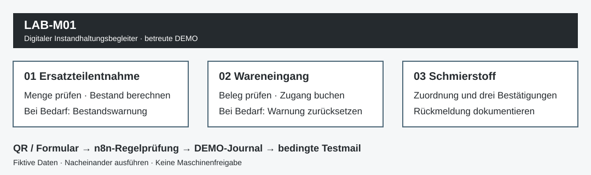

# LAB-M01 · Digitaler Instandhaltungsbegleiter

**Instandhaltung verständlich digitalisieren: Material erfassen, Bestände nachvollziehen, Rückmeldungen dokumentieren.**

Ein privates Demonstrationsprojekt von **Benedict Havertz**, entstanden im Zertifikatslehrgang KI-Automations-Manager/-in (IHK), Oktober 2026. Keine offizielle IHK-Freigabe und kein produktives Instandhaltungssystem.



## Vom Werkstattablauf zur nachvollziehbaren Rückmeldung

| Aufgabe | Automatisierter Ablauf | Praktischer Nutzen |
|---|---|---|
| Ersatzteilentnahme | Artikel, Menge und Fotoprüfung → Lagerbewegung → Bestandswarnung bei erreichter Schwelle | Materialverbrauch und Nachschubbedarf sichtbar machen |
| Wareneingang | Lieferschein und zwei Bestätigungen → Zugang → gegebenenfalls Warnungs-Reset | Zugang und zugehörigen Warnzustand zusammen dokumentieren |
| Schmierstoffrückmeldung | Einfüllstelle und Zuordnung → drei Bestätigungen → Rückmeldung | Einen wiederholbaren Dokumentationsablauf schaffen |

Der QR-Code öffnet ein Formular. **Erst das Absenden startet die Verarbeitung.** In der betreuten DEMO orchestriert n8n die Prüfung, Google Sheets hält die Daten und Gmail versendet die vorgesehenen Testnachrichten. Die Regeln entscheiden deterministisch; ein Sprachmodell entscheidet nicht über Buchungen oder Maschinenfreigaben.

## Was ist getestet?

- **Drei Basisabläufe in n8n mit Gmail geprüft:** Entnahme mit Warnung, Wareneingang mit Reset und Schmierstoffrückmeldung. Interne Laufbelege und Mailresultate wurden ausgewertet.
- **Smartphone-Probelauf persönlich bestätigt:** Der Projektinhaber hat den QR-Aufruf kontrolliert und die Workshop-Demonstration freigegeben.
- **13 unterschiedliche Aufgaben lokal geprüft:** 64 Assertions für Ergebnisse, Bestandsrechnung, Warnentscheidungen und Wiederholungen; neun Materialbewegungen und vier Schmierstoffmeldungen.
- **QR-Druckexport geprüft:** 26 erfolgreiche Decodierungen der 13 Vorderseiten bei zwei Auflösungen.

Die 13 Varianten sind **keine 13 zusätzlichen nachgewiesenen Cloud-Durchläufe**. Umfang, Datum und Grenzen stehen im [Testnachweis](docs/TESTING.md). Der lokale Test versendet keine E-Mails.

## Technische Arbeit, die dieses Projekt zeigt

Prozessaufnahme aus der Instandhaltung · n8n-Integration · JavaScript-Regelprüfung · strukturierte DEMO-Daten · Fehler- und Wiederholungsbehandlung · nachvollziehbare Tests · anfängerfreundliche technische Dokumentation.

Ein konkreter Prüffall: Bestand **6 → 3**, Warnung erzeugen; anschließend Zugang **3 → 6**, Warnung zurücksetzen. Derselbe übermittelte Vorgang darf lokal keine zweite Buchung erzeugen. Die [Entwurfsentscheidungen](docs/DESIGN.md) erläutern auch die Grenze bei gleichzeitigen Eingaben.

## Selbst nachvollziehen

Diese öffentliche Fassung enthält den unveränderten, lokal geprüften JavaScript-Kern, synthetische Testdaten und einen ausführbaren Prüflauf. Sie ist kein vollständig eingerichteter n8n-Import.

```sh
git clone https://github.com/bh-automation/lab-m01-maintenance-demo.git
cd lab-m01-maintenance-demo
node tests/workshop.cjs
```

Voraussetzung: Node.js 22 oder neuer. Keine npm-Pakete, Zugangsdaten oder Cloud-Verbindungen erforderlich. Erwartet: **13 Fälle, 64 bestandene Assertions**. Beispieldaten und Zeitpunkte sind fiktiv. Die Foto-Metadaten sind ein Test-Double für eine vorgelagerte Binärprüfung; dieser Prüflauf untersucht keine Bilddatei.

## Einsatzrahmen

Die DEMO wird **nacheinander unter Moderation** durchgeführt. Google Sheets bietet hier keine transaktionale Mehrbenutzer-Buchung. Keine ERP-Anbindung, keine automatische Bestellung und keine technische Betriebsfreigabe. Gemessene Zeit- oder Kosteneinsparungen werden nicht behauptet. Details: [Architektur und Grenzen](docs/DESIGN.md).

Die Workshop-Karten mit aktiven QR-Zielen, Kontoverbindungen und internen Rohprotokollen bleiben außerhalb dieser öffentlichen Fassung. Das ursprüngliche Entwicklungsarchiv bleibt privat. [Veröffentlichungsprüfung](docs/RELEASE_REVIEW.md).

## Austausch

**Benedict Havertz** · Technische Projekte · Automatisierung · Digitalisierung  
[LinkedIn](https://www.linkedin.com/in/benedict-havertz) · [GitHub](https://github.com/bh-automation) · [E-Mail](mailto:b.havertz2000@gmail.com)

Sie möchten ähnliche Abläufe mit eigenen Testdaten nachbauen oder aus Sicht der Instandhaltung diskutieren? Ich freue mich über fachlichen Austausch.

*English summary: A maintenance workflow demonstrator combining n8n, Google Sheets and Gmail. Includes a reproducible offline JavaScript rule test. Three supervised cloud baseline flows and a user-confirmed smartphone trial are documented separately from 13 locally tested workshop scenarios.*

© 2026 Benedict Havertz. Öffentlich zur Einsicht bereitgestellt; keine zusätzliche Open-Source-Lizenz erteilt.
