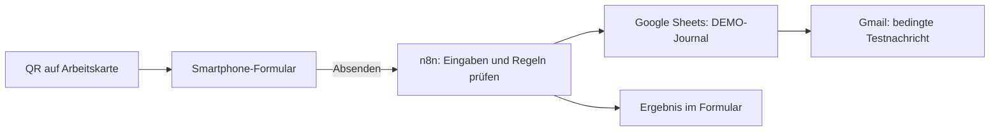

# Architektur und Entwurfsentscheidungen

Das Diagramm zeigt die betreute Cloud-DEMO. In diesem öffentlichen Paket werden ausschließlich die Regeln und synthetischen Zustände lokal ausgeführt; es enthält keinen aktiven Cloud-Zugang.

## Entscheidungen mit Nutzen und Grenze

- **Buchungsjournal:** Startbestand plus gebuchte Bewegungen macht den Bestand nachvollziehbar. Fehlerhafte oder unvollständige Zustände sollen geklärt werden, statt sie still zu übergehen.
- **Wiederholungen erkennen:** Dieselbe Sendung erzeugt im lokalen Prüffall keine zweite Bewegung. Die Kennung verwendet einen kurzen nicht kryptografischen Hash. Sie ist weder Sicherheitsmerkmal noch Garantie gegen Kollisionen oder parallele Schreibzugriffe.
- **Warnung und Reset:** Eine Schwelle löst eine Bestandswarnung aus; ein passender Zugang kann sie zurücksetzen. Die Nachricht ist eine Information und keine Bestellung.
- **Mailstatus getrennt behandeln:** Eine vorbereitete Nachricht ist noch keine erfolgreiche Zustellung. Bei unbestätigtem Versand ist Klärung erforderlich.
- **Drei Bestätigungen bei Schmierstoff:** Die Dokumentation erfasst Aussagen des Teilnehmers. Sie bestätigt keine physisch geprüfte Schmierstoffverträglichkeit und keine Maschinenfreigabe.
- **Foto als Eingangsprüfung:** Der lokale Kern erwartet bereits geprüfte Metadaten. Die reale Binärprüfung liegt im n8n-Eingang und gehört nicht zum öffentlichen Offline-Prüflauf.
- **Didaktik:** 13 unterschiedliche Aufgaben teilen dieselben drei Abläufe. Einfache Schritte, konkrete Soll-Ergebnisse und eine moderierte Reihenfolge machen Automatisierung beobachtbar.

## Bewusste Grenze

Nur synthetische Daten und aufeinanderfolgende Bedienung. Die vorgesehene Meisterrolle ist eine Übungsrolle, keine nachgewiesene Zugriffskontrolle. Keine Mehrbenutzer- oder Produktionsfreigabe, kein ERP, keine gemessene ROI-Aussage. Der separate SQLite-Prototyp ist nicht Teil dieser n8n-Demonstration. Ein unbeaufsichtigter öffentlicher Formulardienst würde zusätzliche Authentisierung, Missbrauchsschutz, Betriebsüberwachung und ein belastbares Persistenzkonzept benötigen.

## Projektarbeit

Benedict Havertz verantwortet den fachlichen Ablauf, die Zielsetzung, den menschlichen Probelauf und die Freigabe. Implementierung, Dokumentation und Prüfungen wurden mit KI-Assistenz bearbeitet. Geschäftsentscheidungen bleiben ausdrücklich in den geprüften Regeln; es gibt keinen frei entscheidenden KI-Buchungsagenten.
